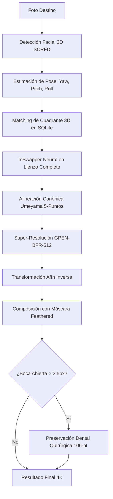

# 🧬 EXON-FACE (EXON 2.0)
> **High-Fidelity 3D Neural Face Synthesis & Canonical Restoration Studio**  
> *Arquitectura limpia hexagonal, emparejamiento multi-ángulo 3D, alineación canónica Umeyama, superresolución GPEN-512 y preservación dental quirúrgica.*

---

## 🌟 Visión General

**EXON-FACE** es una plataforma integral de ingeniería biométrica y síntesis neural de rostros diseñada para resolver los problemas fundamentales del face-swap convencional (ojos fantasma, desenfoque por baja resolución, desalineación angular y pérdida de identidad).

A diferencia de los enfoques tradicionales de parcheo o sobrepintado 2D, EXON-FACE implementa una **reconstrucción neural continua en 3D**:
1. Extrae y categoriza identidades faciales en un banco multi-ángulo de **7 cuadrantes 3D** (Frontal, Picado, Contrapicado, 3/4 y Perfiles).
2. Empareja dinámicamente el ángulo 3D del objetivo con el vector de identidad idóneo.
3. Aplica **alineación canónica Umeyama 5-puntos** y superresolución **GPEN-BFR-512**.
4. Preserva quirúrgicamente la cavidad oral y dientes naturales en expresiones abiertas mediante detección de landmarks 106.

---

## 🚀 Características Principales

* **3D Pose Matching Dinámico**: Clasificación en tiempo real de ángulos de cabeza (`yaw`, `pitch`, `roll`) para seleccionar el embedding óptimo de la identidad fuente, evitando distorsiones anatómicas en poses extremas.
* **Cero Doble Ojo / Cero Fantasmas**: La alineación canónica 5-puntos centra y normaliza la cara antes de la restauración neural, garantizando que el iris, pupilas y pestañas se reconstruyan en perfecta convergencia óptica.
* **Preservación Dental Quirúrgica**: Algoritmo que aísla de forma milimétrica la cavidad interna de la boca (`landmarks 106 [65, 66, 62, 70, 61, 57, 60, 54]`), preservando dientes nítidos y blancos sin alterar la morfología ni el brillo labial.
* **Transición Borde Canónico**: Máscaras difuminadas con erosión y desenfoque gaussiano de 31px en espacio afín inverso, eliminando costuras visibles en el contorno del rostro, cabello o cuello.
* **Curación Inteligente de Datasets**: Scripts automatizados para analizar videos (`.mp4`) y fotos, filtrando frames por nitidez de Laplaciano, apertura de ojos y calidad biométrica.
* **VRAM Slot Management**: Administrador asíncrono de memoria GPU para orquestar la detección, swap y restauración sin desbordar la VRAM.
* **Estudio Web Moderno**: Interfaz interactiva construida en **Next.js 14 + Tailwind CSS** con monitoreo de progreso en tiempo real mediante Server-Sent Events (SSE).

---

## 🏛️ Arquitectura del Sistema

El backend está construido bajo los principios de **Clean Architecture (Hexagonal Ports & Adapters)**:

```
EXON2/
├── backend/
│   ├── src/
│   │   ├── domain/              # Entidades puras, Enums (AngleQuadrant, RenderMode) y Reglas de Negocio
│   │   ├── application/         # Casos de Uso (ExecuteFaceSynthesis, IngestSubjectDataset) y Puertos
│   │   ├── infrastructure/      # Adaptadores (InsightFace, InSwapper, GPEN, SQLite, Storage)
│   │   └── presentation/        # API REST FastAPI, Endpoints SSE, Modelos Pydantic
│   └── scripts/                 # Scripts CLI para curación, pruebas por lotes y benchmarks
├── frontend/                    # Web Studio en Next.js 14, Tailwind CSS, TypeScript
├── datasets/                    # Almacenamiento local de datasets organizados
├── models/                      # Modelos ONNX (InSwapper-128, GPEN-512, Buffalo_L)
├── EJECUTAR_EXON_FACE.bat       # Lanzador 1-clic del entorno completo
└── DETENER_EXON_FACE.bat        # Detención segura de procesos y liberación de VRAM
```

---

## 🛠️ Requisitos del Sistema

* **Sistema Operativo**: Windows 10/11 o Linux.
* **GPU**: NVIDIA RTX (recomendado 6GB+ VRAM, compatible con CUDA 12.1+).
* **Python**: 3.10 o 3.11.
* **Node.js**: 18.x o superior.

---

## 📦 Instalación y Configuración

### 1. Clonar el Repositorio
```bash
git clone https://github.com/bmontes93/Exon2.git
cd Exon2
```

### 2. Backend (Python)
Crear y activar un entorno virtual con soporte GPU:
```bash
cd backend
python -m venv .venv_cuda
# En Windows:
.venv_cuda\Scripts\activate
# En Linux:
source .venv_cuda/bin/activate

pip install -r requirements.txt
# O instalar dependencias principales:
pip install torch torchvision --index-url https://download.pytorch.org/whl/cu121
pip install onnxruntime-gpu insightface opencv-python fastapi uvicorn pillow
```

### 3. Frontend (Next.js)
```bash
cd ../frontend
npm install
```

### 4. Modelos ONNX
Colocar los pesos en el directorio `models/`:
* `models/swappers/inswapper_128.onnx`
* `models/codeformer/GPEN-BFR-512.onnx`
* `models/models/buffalo_l/` (`1k3d68.onnx`, `2d106det.onnx`, `det_10g.onnx`, `genderage.onnx`, `w600k_r50.onnx`)

---

## ⚡ Ejecución Rápida

### En Windows (1-Clic):
Hacer doble clic en:
* **`EJECUTAR_EXON_FACE.bat`**: Inicia automáticamente el backend (puerto 8000) y el frontend web (puerto 3000).
* **`DETENER_EXON_FACE.bat`**: Detiene todos los servicios y libera la GPU.

### Manualmente:
```bash
# Terminal 1 - Backend:
cd backend
.venv_cuda\Scripts\activate
uvicorn src.presentation.api.main:app --host 127.0.0.1 --port 8000 --reload

# Terminal 2 - Frontend:
cd frontend
npm run dev
```

Acceder al estudio web en: [http://localhost:3000](http://localhost:3000)

---

## 📊 Pipeline Neural Paso a Paso



---

## 📄 Licencia

Este proyecto está bajo la licencia MIT. Consulta el archivo `LICENSE` para más detalles.
