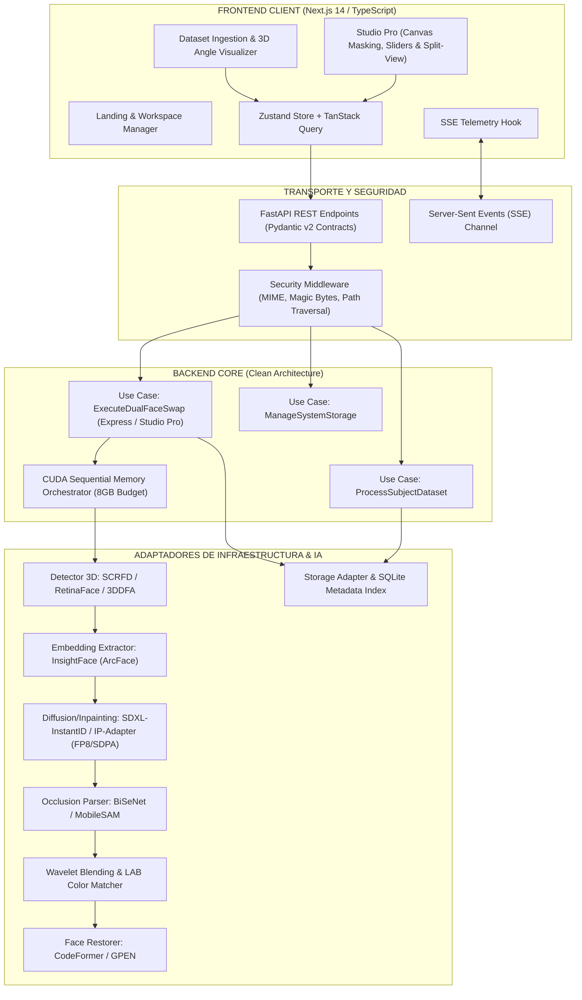

# PLAN.MD — PLAN ARQUITECTÓNICO Y DE INGENIERÍA DEL SISTEMA EXON-FACE

**Versión:** 1.0.0  
**Estado:** PROPUESTO PARA APROBACIÓN  
**Metodología:** Clean Architecture / Hexagonal & DevSecOps  
**Fecha:** 2026-09-02  

---

## 1. VISIÓN GENERAL DE LA ARQUITECTURA

El sistema **EXON-FACE** se estructura en dos subsistemas completamente desacoplados y autónomos:
1. **Core Backend (FastAPI + PyTorch/ONNX Engine)**: Orquesta la ingesta de datasets, estimación de pose 3D, síntesis generativa, segmentación de oclusiones y fusión de frecuencias.
2. **Frontend UI (Next.js + TypeScript + Tailwind)**: Interfaz de usuario de alta fidelidad basada en estética *Neo-Brutalist Industrial*, con soporte para manipulación de máscaras en canvas y comparador antes/después en tiempo real.



---

## 2. ESTRUCTURA MODULAR DEL PROYECTO

### 2.1. Backend (`/backend`)
```
backend/
├── pyproject.toml              # Dependencias y configuración de herramientas
├── pytest.ini                  # Configuración de pruebas TDD y cobertura
├── src/
│   ├── __init__.py
│   ├── domain/                 # Entidades y lógica pura de negocio
│   │   ├── __init__.py
│   │   ├── entities.py         # FaceCrop, HeadPose3D, IdentityProfile, RenderJob, MaskData
│   │   ├── enums.py            # RenderMode, AngleQuadrant, LogLevel, EngineStatus
│   │   └── exceptions.py       # DomainErrors (FaceNotFound, VRAMExceeded, SecurityViolation)
│   ├── application/            # Casos de uso e interfaces
│   │   ├── __init__.py
│   │   ├── ports/              # Interfaces abstractas (IA, Storage, Memory)
│   │   │   ├── face_detector.py
│   │   │   ├── identity_extractor.py
│   │   │   ├── neural_renderer.py
│   │   │   ├── face_parser.py
│   │   │   ├── image_blender.py
│   │   │   └── storage_repository.py
│   │   └── use_cases/          # Lógica de orquestación
│   │       ├── ingest_subject_dataset.py
│   │       ├── execute_face_synthesis.py
│   │       └── configure_system_paths.py
│   ├── infrastructure/         # Implementaciones concretas
│   │   ├── __init__.py
│   │   ├── memory/             # Orquestador CUDA VRAM (Secuencial + Empty Cache)
│   │   │   └── vram_orchestrator.py
│   │   ├── adapters/           # Adaptadores de modelos de IA
│   │   │   ├── scrfd_detector.py
│   │   │   ├── insightface_embedder.py
│   │   │   ├── diffusers_renderer.py
│   │   │   ├── bisenet_parser.py
│   │   │   ├── wavelet_blender.py
│   │   │   └── codeformer_enhancer.py
│   │   └── storage/            # Persistencia local y SQLite
│   │       ├── local_storage_adapter.py
│   │       └── sqlite_metadata_repo.py
│   └── interfaces/             # API web y DTOs
│       ├── __init__.py
│       ├── api/
│       │   ├── app.py          # Factoría FastAPI y Middlewares
│       │   ├── routers/
│       │   │   ├── dataset_router.py
│       │   │   ├── render_router.py
│       │   │   └── system_router.py
│       │   └── sse_manager.py  # Gestor de eventos en tiempo real
│       └── schemas/            # Esquemas Pydantic v2
│           ├── dataset_schemas.py
│           ├── render_schemas.py
│           └── system_schemas.py
└── tests/                      # Suite de pruebas automatizadas
    ├── unit/
    │   ├── test_security_sanitization.py
    │   ├── test_vram_orchestrator.py
    │   ├── test_wavelet_blender.py
    │   └── test_use_cases.py
    ├── integration/
    │   ├── test_api_routes.py
    │   └── test_sse_streaming.py
    └── security/
        ├── test_path_traversal.py
        └── test_malicious_payloads.py
```

### 2.2. Frontend (`/frontend`)
```
frontend/
├── package.json
├── tsconfig.json
├── tailwind.config.ts
├── src/
│   ├── app/
│   │   ├── layout.tsx          # Shell principal con tema Neo-Brutalist
│   │   ├── page.tsx            # Dashboard y navegación de workspaces
│   │   ├── dataset/page.tsx    # Vista de ingesta y catálogo 3D
│   │   ├── studio/page.tsx     # Vista Studio Pro con Canvas y Sliders
│   │   └── settings/page.tsx   # Configuración de rutas en disco y GPU
│   ├── components/
│   │   ├── ui/                 # Componentes base Brutalistas
│   │   │   ├── BrutalButton.tsx
│   │   │   ├── BrutalCard.tsx
│   │   │   ├── BrutalSlider.tsx
│   │   │   ├── BrutalBadge.tsx
│   │   │   └── BrutalModal.tsx
│   │   ├── studio/             # Componentes del editor
│   │   │   ├── SplitViewSlider.tsx
│   │   │   ├── MaskDrawingCanvas.tsx
│   │   │   ├── TelemetryConsole.tsx
│   │   │   └── RenderParamSliders.tsx
│   │   └── dataset/
│   │       ├── SubjectCard.tsx
│   │       ├── AngleGridVisualizer.tsx
│   │       └── IngestDropzone.tsx
│   ├── hooks/
│   │   ├── useSSEProgress.ts
│   │   └── useRenderJob.ts
│   ├── services/
│   │   └── api.ts              # Cliente API tipado con Axios
│   └── stores/
│       ├── useAppStore.ts      # Estado global (configuración, tema)
│       └── useStudioStore.ts   # Estado de sesión de renderizado
```

---

## 3. FLUJO DE DATOS Y SECUENCIA DE RENDERIZADO

```mermaid
sequenceDiagram
    autonumber
    actor User as Usuario (Frontend)
    participant API as FastAPI REST / SSE
    participant Sec as Security & Validator
    participant UC as ExecuteFaceSynthesis UseCase
    participant VRAM as VRAM Orchestrator (8GB Cap)
    participant Detect as 3D Detector / 3DDFA
    participant Diff as Generador Diffusers (InstantID)
    participant Post as Wavelet & CodeFormer
    participant Store as Local Storage

    User->>API: POST /api/v1/render/execute (Params + Target Image)
    API->>Sec: Validar Headers, Magic Bytes y Path Traversal
    Sec-->>API: Aprobado
    API->>UC: Iniciar Trabajo de Render
    API-->>User: Retorna JobID (202 Accepted) & Conexión SSE
    
    rect rgb(20, 30, 40)
        Note over UC,VRAM: Fase 1: Detección y Pose 3D
        UC->>VRAM: acquire_slot("detect")
        VRAM->>Detect: Cargar modelo liviano
        Detect-->>UC: Pose 3D (Yaw, Pitch, Roll) & Landmarks
        VRAM->>VRAM: Liberar modelo y limpiar caché CUDA
        UC->>API: SSE: Progreso 20% (Pose 3D calculada)
    end

    rect rgb(30, 20, 40)
        Note over UC,VRAM: Fase 2: Inyección de Identidad y Difusión
        UC->>VRAM: acquire_slot("diffuse")
        VRAM->>Diff: Cargar SDXL-InstantID (FP8 / SDPA)
        Diff-->>UC: Imagen Sintetizada Raw
        VRAM->>VRAM: Liberar modelo y limpiar caché CUDA
        UC->>API: SSE: Progreso 60% (Síntesis Generativa completada)
    end

    rect rgb(20, 40, 30)
        Note over UC,VRAM: Fase 3: Post-Procesamiento (Wavelet + CodeFormer)
        UC->>Post: Fusión de Frecuencias (Preservar Poros/Grano)
        UC->>Post: Restaurador Facial (Fidelidad 0.75)
        Post-->>UC: Imagen Final Ultra-Fidelidad
        UC->>Store: Guardar PNG/EXR en OUTPUT_DIR
        UC->>API: SSE: Progreso 100% (Render Finalizado)
    end

    User->>API: GET /api/v1/render/result/{job_id}
    API-->>User: Retorna URL de Imagen y Metadatos de Telemetría
```



---

## 4. ESTRATEGIA DE GESTIÓN DE VRAM (8 GB LIMIT)

Para garantizar la estabilidad en la **RTX 3070 8GB**, el componente `VRAMOrchestrator` implementará un patrón de máquina de estados estricto:

| Fase de Pipeline | Modelos Residentes en VRAM | Uso Estimado VRAM | Acción al Finalizar |
| :--- | :--- | :--- | :--- |
| **1. Detección & Pose** | SCRFD + 3DDFA | $\approx 1.2 \text{ GB}$ | `del model; torch.cuda.empty_cache()` |
| **2. Embeddings** | ArcFace (InsightFace) | $\approx 0.8 \text{ GB}$ | Extracción a RAM de CPU, liberar GPU |
| **3. Síntesis Generativa** | InstantID + ControlNet (FP8 / SDPA) | $\approx 5.8 \text{ GB}$ | Inferencia por pasos, descarga inmediata a CPU |
| **4. Segmentación Facial** | BiSeNet Face Parsing | $\approx 1.0 \text{ GB}$ | Inferencia de máscara, liberar GPU |
| **5. Wavelet & Color** | Algoritmos NumPy / SciPy | $\approx 0.0 \text{ GB}$ (CPU) | No consume VRAM |
| **6. Restauración** | CodeFormer | $\approx 2.1 \text{ GB}$ | Inferencia final y limpieza total de GPU |

---
**Documento listo para ser acompañado por `tasks.md`.**
